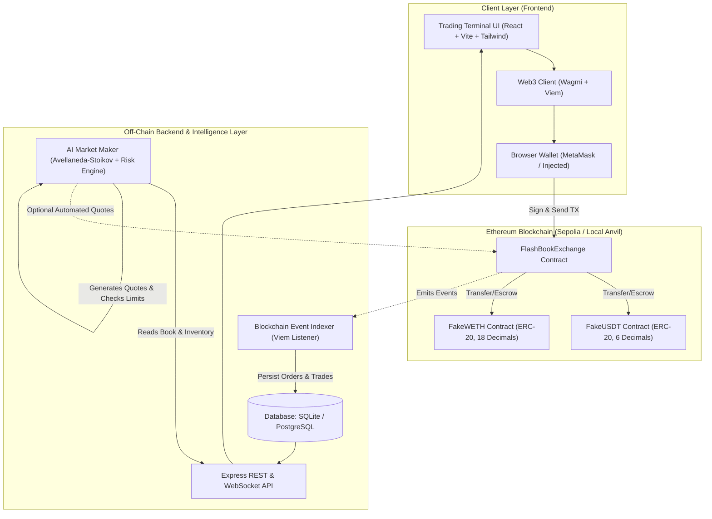

# FlashBook AI — Architecture Specification

**System:** FlashBook AI Decentralized Trading Platform  
**Target Networks:** Ethereum Sepolia (Chain ID: 11155111) & Local Anvil (Chain ID: 31337)

---

## 1. High-Level Architecture Overview



---

## 2. Component Design

### 2.1 Smart Contract Layer (`contracts/`)

1. **`MockERC20` (FakeUSDT & FakeWETH):**
   - Standard ERC-20 implementation with `name`, `symbol`, and configurable `decimals` (6 for FakeUSDT, 18 for FakeWETH).
   - Built-in `faucet()` function allowing test accounts to claim 1,000 FakeUSDT and 1 FakeWETH once per cooldown period.

2. **`FlashBookExchange`:**
   - **Order Book State:**
     - Order struct:
       ```solidity
       enum Side { BUY, SELL }
       enum OrderStatus { ACTIVE, FILLED, PARTIALLY_FILLED, CANCELLED }

       struct Order {
           uint256 id;
           address maker;
           Side side;
           uint256 price;       // Scaled by 1e6 (Quote asset units per 1e18 Base asset)
           uint256 amount;      // Base asset amount (1e18)
           uint256 filledAmount;// Base asset amount filled so far
           uint256 timestamp;
           OrderStatus status;
       }
       ```
     - Price-Time Priority matching engine:
       - Limit Buy matches against active Sell orders where `order.price <= buyPrice` (lowest ask first, then earliest order ID).
       - Limit Sell matches against active Buy orders where `order.price >= sellPrice` (highest bid first, then earliest order ID).
       - Immediate partial/full match on order placement. Unfilled remainder is placed on the book.
     - **Escrow Accounting:**
       - Buy Order requires escrow of `(amount * price) / 1e18` quote tokens (`FakeUSDT`).
       - Sell Order requires escrow of `amount` base tokens (`FakeWETH`).
       - On match: Maker & taker tokens are atomically swapped. Protocol fees (if enabled) are deducted.
       - On cancellation: Remaining unfulfilled escrow is instantly returned to the maker.

### 2.2 Backend & Indexing Layer (`backend/`)

- **Blockchain Event Indexer:**
  - Connects to RPC provider.
  - Subscribes to events: `OrderPlaced`, `OrderMatched`, `OrderCancelled`, `FeeUpdated`.
  - Idempotent ledger updates: Each event is indexed with `blockNumber`, `transactionHash`, and `logIndex`.
- **Database Schema:**
  - `markets`: Pair configs (symbol, baseToken, quoteToken, minSize, tickSize).
  - `orders`: Indexed order records (id, maker, side, price, amount, filledAmount, status, txHash).
  - `trades`: Matched trades (tradeId, buyOrderId, sellOrderId, price, amount, buyer, seller, txHash, timestamp).
  - `market_maker_decisions`: Logs of AI pricing decisions, mid-prices, spreads, inventory skew, and actions taken.
- **REST Endpoints:**
  - Fast, indexed responses for UI responsiveness and historical charts (OHLCV, trade feeds, order books).

### 2.3 AI-Assisted Market Maker (`backend/src/market-maker/`)

- **Mathematical Model:**
  - Uses the **Avellaneda-Stoikov** optimal market making formulation:
    $$r(s, q) = s - q \cdot \gamma \cdot \sigma^2$$
    Where:
    - $s$: Mid-market reference price.
    - $q$: Current net inventory relative to target ($q_{base} - q_{target}$).
    - $\gamma$: Risk aversion parameter.
    - $\sigma$: Realized volatility of recent trades.
  - Optimal bid and ask quotes:
    $$r^b = r(s, q) - \frac{\delta}{2}, \quad r^a = r(s, q) + \frac{\delta}{2}$$
    Where $\delta$ is the dynamic half-spread determined by market volatility and liquidity depth.
- **Safety & Risk Engine:**
  - Never quotes if spread is inverted ($r^b \ge r^a$).
  - Max single quote size cap (e.g. 0.5 WETH).
  - Max cumulative inventory deviation limit.
  - Circuit breaker trips and freezes quoting if price shifts > 5% within 10 blocks.
  - Defaults to **Dry-Run Mode** (recommends quotes, records decisions, but does not send transactions unless explicitly enabled with a funded key).

### 2.4 Frontend Trading Terminal (`frontend/`)

- Built with React 18, TypeScript, Tailwind CSS, Wagmi, Viem, and Recharts.
- Sleek dark DeFi terminal design system:
  - Deep obsidian backgrounds (`#0B0E14`, `#121722`).
  - High-contrast typography and semantic color coding (Emerald `#00F59B` for bids/buys, Crimson `#FF4B72` for asks/sells).
  - Real-time updates with visual flash indicators on new trades or book shifts.
  - Non-custodial interaction: all transactions are executed directly by the user's wallet via Wagmi/Viem.
