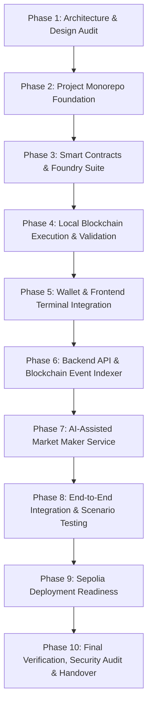

# FlashBook AI — Implementation Plan

**Protocol Version:** 1.0.0  
**Target Environment:** Local Anvil & Ethereum Sepolia Testnet

---

## 1. Overview of Execution Phases

---

## 2. Phase-by-Phase Breakdown

### Phase 1: Repository Audit & Technical Design (Current)
- Initialize project docs (`PROJECT_AUDIT.md`, `IMPLEMENTATION_PLAN.md`, `ARCHITECTURE.md`, `SECURITY_MODEL.md`, `TEST_PLAN.md`).
- Document matching model, accounting invariants, and test coverage requirements.

### Phase 2: Project Monorepo Foundation
- Configure monorepo structure with `contracts/`, `backend/`, and `frontend/`.
- Configure Foundry in `contracts/` with OpenZeppelin contracts.
- Configure Node.js TypeScript build in `backend/`.
- Configure Vite + React + TypeScript + Tailwind CSS in `frontend/`.
- Establish unified workspace scripts in root `package.json`.

### Phase 3: Smart Contracts Implementation
- Implement `MockERC20` (FakeUSDT - 6 decimals, FakeWETH - 18 decimals) with controlled minting/fauceting.
- Implement `FlashBookExchange`:
  - Token pair registration (`baseToken`, `quoteToken`).
  - Escrow balance tracking (`lockedBalances`, `availableBalances`).
  - Order placement (`placeLimitBuy`, `placeLimitSell`).
  - Order matching logic (Price-Time priority, atomic balance settlement, fee collection).
  - Order cancellation (`cancelOrder`) with refund of remaining locked escrow.
  - Emergency administration: `pause()`, `unpause()`, fee updates.
- Write Foundry tests (`test/FlashBookExchange.t.sol`):
  - Unit tests for placement, matching, cancellation, fees.
  - Fuzz tests for varied order prices and sizes.
  - Invariant tests for total token preservation.

### Phase 4: Local Blockchain Validation
- Launch Anvil test node.
- Deploy contracts via Foundry script.
- Execute test transactions using `cast` and scripts (mint tokens, approve, place orders, match, cancel).
- Verify gas usage and event logs.

### Phase 5: Wallet and Frontend Integration
- Build dark trading terminal interface:
  - Header with pair selector, live price metrics, faucet button, and Wagmi wallet connector.
  - Real-time Order Book with bids, asks, spread, and depth bars.
  - Trading Form with Buy/Sell toggle, price/amount inputs, balance indicators, and 1-click token approvals.
  - Price & Depth Charts using Recharts.
  - Open Orders table with real-time cancel buttons and status chips.
  - Recent Trades feed with transaction links.
  - AI Market Maker control & telemetry panel.
- Ensure strict error handling for disconnected wallet, wrong network (Sepolia/Anvil switch), and pending/reverted transactions.

### Phase 6: Backend & Event Indexer
- Set up Express REST API with TypeScript.
- Set up database layer (SQLite for frictionless local execution + Postgres migration compatibility).
- Implement blockchain event indexer listening to `OrderPlaced`, `OrderMatched`, `OrderCancelled`.
- Expose REST API routes for:
  - `/api/markets` (ticker info, 24h volume, high, low)
  - `/api/orderbook` (aggregated bids/asks)
  - `/api/trades` (historical trade events)
  - `/api/orders` (user-specific open/closed orders)
  - `/api/analytics` (candle/depth data)

### Phase 7: AI-Assisted Market Maker
- Implement Avellaneda-Stoikov market making engine:
  - Mid-price estimation and statistical volatility tracker.
  - Reservation price and optimal bid-ask spread calculation.
  - Inventory skew dampening.
- Implement risk guards:
  - Max order size per tick.
  - Exposure limits.
  - Circuit breaker for sudden volatility spikes.
  - Dry-run mode and manual kill-switch.
  - REST endpoints to inspect AI decisions and configure parameters.

### Phase 8: End-to-End Testing & Integration
- Verify the complete cycle:
  - User A places limit buy order.
  - User B places limit sell order matching price.
  - On-chain atomic settlement occurs.
  - Event indexer picks up logs and updates backend database.
  - Frontend updates order book, trade feed, and user balances in real time.
  - Market Maker bot calculates optimal quotes and submits updates.

### Phase 9: Sepolia Deployment Readiness
- Provide deployment script `script/DeploySepolia.s.sol`.
- Configure network endpoints, chain ID checks, and explorer URLs.
- Document deployment checklist and provide clean `.env.example`.

### Phase 10: Final Audit & Handover
- Execute all test suites (Foundry, Backend, Frontend).
- Complete status table with verified evidence.
- Produce comprehensive README and user guide.
