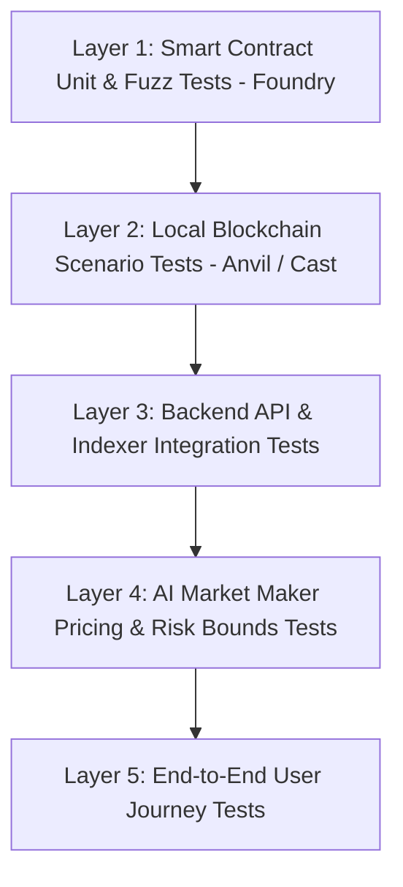

# FlashBook AI — Test Plan & Quality Assurance Strategy

**Target Quality Standard:** Hackathon & Pre-Audit Production Grade  
**Frameworks:** Foundry (`forge test`), Vitest / Jest, Playwright / Component Unit Testing

---

## 1. Test Layers & Scope

---

## 2. Test Suites

### Suite 1: Smart Contracts (`contracts/test/FlashBookExchange.t.sol`)
1. **Faucet & ERC-20 Setup:**
   - Minting FakeUSDT (6 decimals) and FakeWETH (18 decimals).
   - Approval and allowance verification.
2. **Order Placement:**
   - Place Limit Buy: verify quote token escrowed, order stored with `ACTIVE` status, `OrderPlaced` emitted.
   - Place Limit Sell: verify base token escrowed, order stored with `ACTIVE` status.
   - Revert on zero price or zero amount.
   - Revert on insufficient balance or insufficient allowance.
3. **Order Cancellation:**
   - Cancel active order by maker: verify status updated to `CANCELLED`, escrowed funds returned 100%.
   - Revert if non-maker attempts to cancel.
   - Revert if order is already filled or cancelled.
4. **Order Matching & Settlement:**
   - Exact matching: Maker Limit Sell at 3,000 USDT, Taker Limit Buy at 3,000 USDT.
   - Atomic exchange: Maker receives 3,000 USDT, Taker receives 1 WETH. Both orders marked `FILLED`.
   - Partial fills: Maker Limit Sell of 2 WETH at 3,000 USDT. Taker Limit Buy of 1 WETH at 3,000 USDT.
     - Maker order remains `PARTIALLY_FILLED` with 1 WETH remaining.
     - Taker order is `FILLED`.
   - Price improvement: Maker Limit Sell at 2,900 USDT. Taker Limit Buy at 3,000 USDT.
     - Settles at maker's favorable price (2,900 USDT).
     - Taker receives excess refunded or matched at 2,900 USDT.
5. **Fee Accounting:**
   - Protocol fee deduction (e.g. 10 bps).
   - Fee withdrawal by protocol owner.
6. **Fuzz & Invariant Testing:**
   - Fuzz order prices ($100 to $100,000) and order sizes ($0.01$ WETH to $100$ WETH).
   - Invariant: Total token balance of exchange contract equals sum of locked escrows + unwithdrawn fees. Zero token leak.
7. **Emergency Circuit Breaker:**
   - Pause exchange: order placement and matching revert.
   - Cancellations remain functional during pause to allow user fund recovery.

### Suite 2: AI Market Maker (`backend/test/marketMaker.test.ts`)
1. **Avellaneda-Stoikov Formula Verification:**
   - Reservation price shifts down when inventory is long ($q > 0$).
   - Reservation price shifts up when inventory is short ($q < 0$).
   - Spread widens during high volatility ($\sigma$).
2. **Risk Bounds & Circuit Breakers:**
   - Rejects orders exceeding `maxOrderSize`.
   - Trips circuit breaker on sharp price movement (> 5%).
   - Dry-run mode produces recommendations without sending transactions.

### Suite 3: Backend API & Indexer (`backend/test/api.test.ts`)
1. REST endpoints return valid schemas:
   - `GET /api/markets`
   - `GET /api/orderbook`
   - `GET /api/trades`
   - `GET /api/orders`
   - `GET /api/market-maker/status`
2. Idempotent event ingestion: re-indexing the same block or tx does not duplicate trades.

### Suite 4: End-to-End Scenario Verification
1. Connect Wallet -> Claim Faucet -> Approve Token -> Place Limit Order -> View in Order Book.
2. Second Wallet -> Match Order -> View Real-time Fill -> Verify Balances in Wallet.
